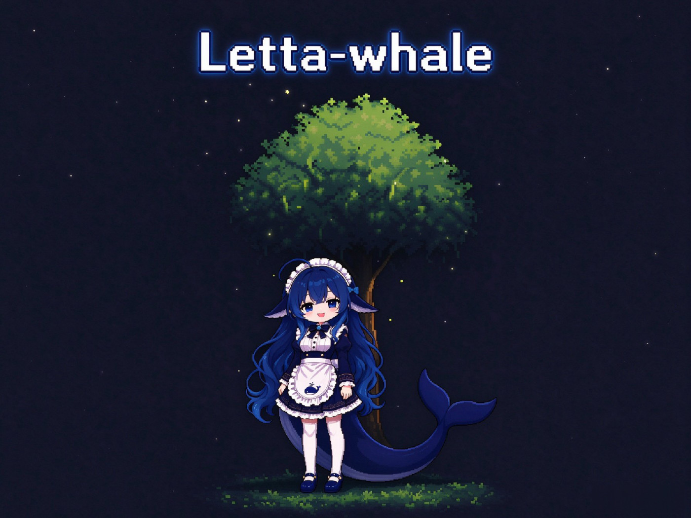

# 养鱼 1000 小时后，我发现了长期记忆的秘密是遗忘。

[](./LICENSE) [](#) [](#) [](https://docs.letta.com/concepts/memfs) [](#-它真的有用吗)

<p align="center"><b><span style="color:#4E8DFF">深海不会遗忘</span><span style="color:#8B7BF0">，</span><span style="color:#C07BE0">它只是等一次洄游</span></b></p>




---

## 🧠 为什么「遗忘」是长期记忆的秘密

这不是玄学，是有认知科学依据的工程取舍。人脑从来不是硬盘，它靠**主动遗忘**来保持高效。letta-bridge 把几条经典理论翻译成了脚本规则：

| 科学机制                    | 通俗解释                | 本项目怎么实现                                                         |
| ----------------------- | ------------------- | --------------------------------------------------------------- |
| **存储强度 vs 提取强度**（Bjork） | 「记不住」往往不是没存进去，是取不出来 | 遗忘 = 降一层可提取性：核心区 → 深水区 → `archive/` → git 历史，**从不真删**           |
| **编码时的情绪标记**            | 情绪越强的事记得越牢          | 每条事件标重要度 `1–3`；`3`（雷点/约定/大事/强情绪）**永不淡忘**                        |
| **用进废退**（提取强化）          | 常想起的事记得更牢           | `memory_read` / `memory_search` 命中即写入 `recall.jsonl`，被想起 = 重新计时 |
| **突触稳态**（睡眠降噪）          | 睡觉时大脑清理噪声           | `forget-plan.mjs` 按规则算淡忘名单：重要度 1 闲置 120 天、2 闲置 210 天            |
| **再学习 / 再巩固**           | 被提醒后又能想起来           | 已淡忘的旧事被直接读到 → 下周整理时「唤回」`events/`                                |
| **系统巩固**（经历→认识）         | 从一堆事里总结出「他最近压力大」    | ≥3 件事指向同一结论 → 写进 `human.md` 的「近期状态」，60 天无佐证自动过期                 |

一句话：**忘记，是为了让真正重要的东西更容易被想起。**

---

## 🏗️ 它是怎么工作的

```
  QQ 私聊 ─ SnowLuma(OneBot v11) ─ QQ→DSH 桥接插件
                                        │
                                        ▼
┌──────────── DSH 桌面版（陪聊主体，deepseek-flash）────────────┐
│ 系统提示稳定段：MEMORY.md + persona.md + human.md               │
│   （按文件 mtime 缓存：不变则逐字节不变 → 命中前缀缓存）          │
│ 尾部：memory_search / memory_read 的按需结果                    │
└───────────────┬──────────────────────────────▲───────────────┘
                │ memory_note（append-only，0 次 LLM）│ 只读
                ▼                              │ read/search 命中记入 recall.jsonl
  ~/.letta-bridge/inbox/notes.jsonl     <MEMORY_DIR>/*.md（MemFS，git 版本化）
                │ dream.ps1（每天 03:00）        ▲ 改写 + git commit
                ▼                              │
┌──────────────── Letta「记忆管家」（离线，deepseek-flash）────────┐
│ 每天：读规则 + 笔记 → 合并/去重/消解冲突/标重要度 → 改写 → 提交    │
│ 每周：提炼近期状态 → 按遗忘计划淡忘/唤回事件 → 收敛常驻区 → 提交   │
└─────────────────────────────────────────────────────────────────┘
```

四条数据流，各司其职：

- **读**：每次组装提示词，插件只 `stat` 三个核心文件；没变就返回同一段文本（缓存命中），变了才重读。DSH 常驻也**不需要重启**。
- **记**：模型判断「这条值得长期留」→ `memory_note` 追加一行 JSON 到收件箱。**不调 LLM、不阻塞对话。**
- **整合（每天）**：`dream.ps1` 把收件箱原子改名成快照再处理（新笔记不会丢），交给 Letta 管家改写成结构化记忆并 `git commit`。
- **深化与遗忘（每周）**：满 7 天时，`forget-plan.mjs` 按固定规则（**0 LLM**）算出淡忘/唤回清单，管家照单执行，并把零散经历提炼成「对这个人的认识」。

### 记忆是分层的，像冰山

| 层级                 | 文件                                                | 进上下文？               | 成本                      |
| ------------------ | ------------------------------------------------- | ------------------- | ----------------------- |
| 🧊 **常驻核心区**       | `persona.md`（我是谁）、`human.md`（你是谁）、`MEMORY.md`（索引） | 每轮都进                | ~900 tokens，命中缓存 ≈ 白菜价  |
| 🌊 **深水区**         | `events/`（事件线）、`people/`（你身边的人）、`topics/`（长期话题）   | 不进，按需 `memory_read` | 0 常驻成本                  |
| 📦 **阁楼（archive）** | `archive/events/…`（已淡忘的旧事）                        | 不进、不参与检索            | 只在被直接读取时「唤回」            |
| 🕰️ **时间机器**       | git 历史                                            | 永不加载                | 人设被改坏？`git revert` 一键回滚 |

---

## 🛠️ 插件提供的 4 个工具

对话里的 agent 只会用到这四个轻量工具，全部零/极低 LLM 成本：

| 工具              | 作用                                    | 成本             |
| --------------- | ------------------------------------- | -------------- |
| `memory_list`   | 列出记忆文件树，让模型知道「去哪找」                    | 本地 IO          |
| `memory_search` | 关键词检索（空格分词，需同时命中），返回 `path:line`      | ≤40 条命中        |
| `memory_read`   | 读单个 `.md`（也能读 `archive/` 里的旧事，触发「唤回」） | 单次 ≤20k 字符     |
| `memory_note`   | 往收件箱写一行流水账，下次做梦时整合                    | **0 次 LLM 调用** |

---


## 💰 Token 账

遗忘和分层的直接回报，就是省钱省上下文：

| 项    | 本方案                         | 对照：在线蒸馏型（每条消息跑一次 LLM） |
| ---- | --------------------------- | --------------------- |
| 每轮注入 | 核心区 ~900 tokens（命中缓存极廉价）    | 召回 1–3k tokens + 摘要维护 |
| 写入成本 | `memory_note` = **0 次 LLM** | 每条消息 2–3k tokens 蒸馏   |
| 整合成本 | 攒够一批笔记跑一次                   | 40 条/天 × 2.7k tokens  |
| 周整理  | 每周一次，≈1 万 token 输入          | —                     |
| 缓存失效 | 每天做梦后一次                     | **每轮**                |

---

🔬 它真的有用吗？
我们不喜欢只报喜的 benchmark。规模记忆效果对照（统一 deepseek-flash，temperature=0，2026-11-01）的核心结果：

轮次	对照组	已知事实答对	无依据问题正确拒答
round-1	仅核心画像	4/7	2/2
round-1	模型生成简单摘要	7/7	2/2
round-1	当前桥 + Letta 本地整理	7/7	2/2
round-2	仅核心画像	6/7	2/2
round-2	模型生成简单摘要	7/7	2/2
round-2	当前桥 + Letta 本地整理	6/7	2/2
这种「把话说清楚」的态度，可能比一个漂亮的数字更值得你 star。

---

## 🧭 设计哲学

1. **记忆就是文件。** 不是黑盒向量库，是你能用记事本打开、能 `git diff`、能一键回滚的 Markdown。
2. **对话链路零侵入。** 主循环还是 DSH，Letta 只在夜里干活。绝不让一条消息被推理两遍。
3. **写入永远廉价。** 记一条 = append 一行 JSON，不调模型、不卡对话。整理是离线批处理的事。
4. **遗忘是一等公民。** 从第一天就把「怎么忘」和「怎么记」当成同等重要的问题设计。
5. **只让 Letta 写 MemFS。** 职责切干净，git 冲突就只可能出现在一侧。


---

## 🙏 致谢

站在这些项目的肩膀上：

- [Letta](https://github.com/letta-ai/letta) —— 有状态 agent 框架，MemFS 的灵感来源
- [SnowLuma](https://github.com/SnowLuma/SnowLuma) —— QQ 协议端
- DeepSeek Harness —— 那个陪我聊了一千小时的「大肥鱼」

以及 Bjork、艾宾浩斯，和所有研究「人是怎么遗忘的」的科学家——**是你们教会了这条鱼怎么忘记。**

---

## 📄 License

[MIT](./LICENSE) © 2026 wangbingbbings

---

**如果这个项目让你对「AI 记忆」有了新想法，给它一个 ⭐ 吧。**

*毕竟，能被记住，是一件很珍贵的事。*
